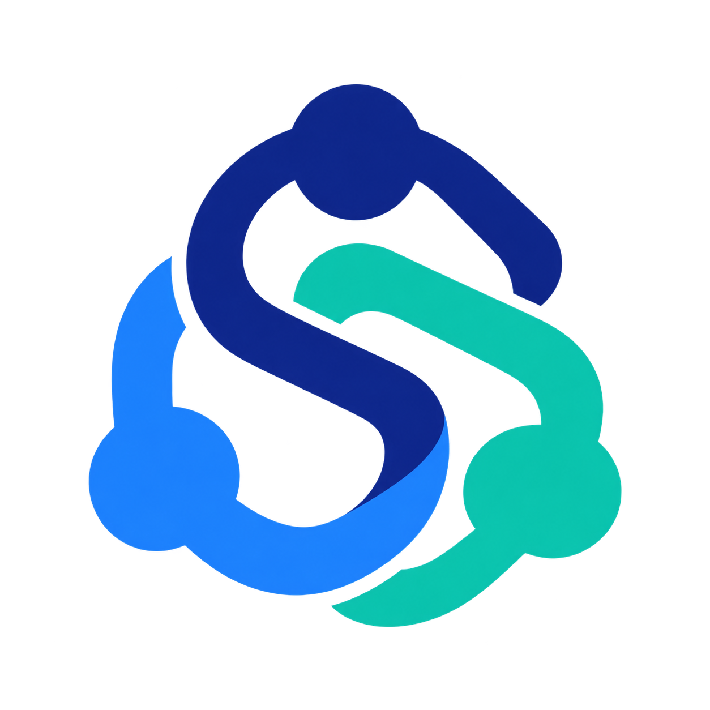
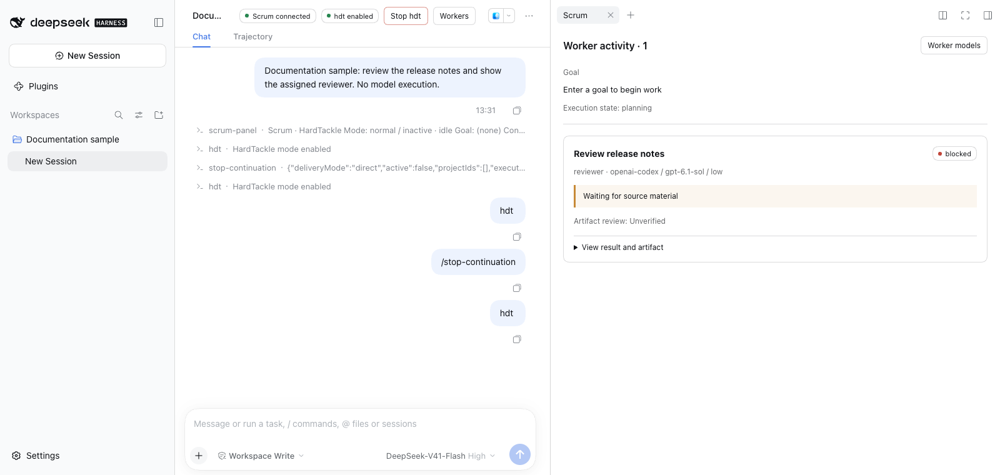
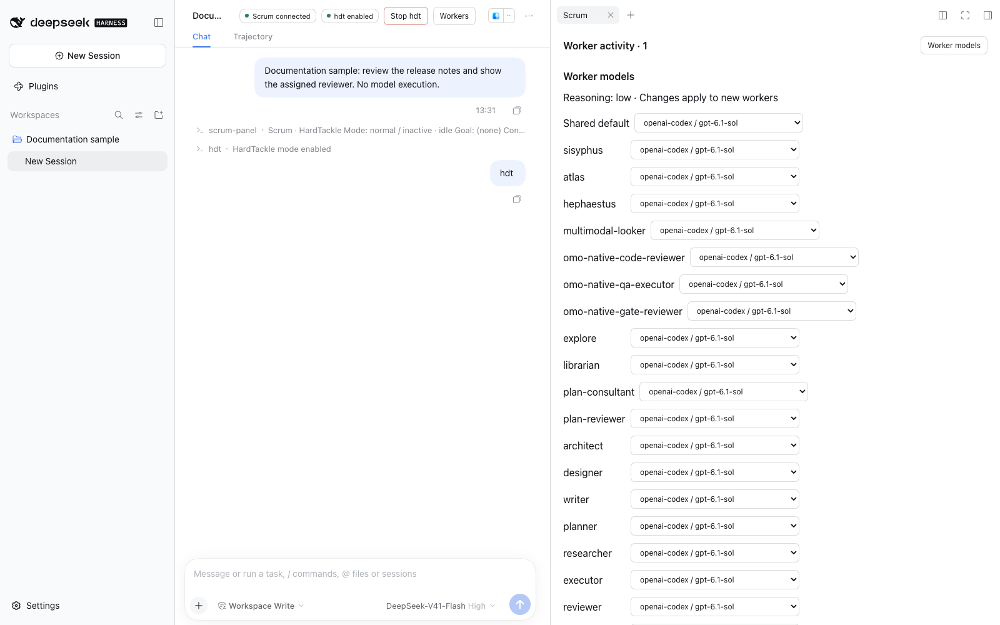

<p align="center">
  
</p>

# Scrum

**DSHで、計画・担当への委譲・結果回収・成果物確認をつなぐマルチエージェントプラグイン。**

依頼を親エージェントに伝え、担当の役割とモデルを割り当て、結果を親へ回収します。成果物を確認し、タスクの状態を更新するまでを同じ実行記録で管理します。

```text
hdt このプロジェクトの不具合を調査して修正し、テストと成果物の確認まで行ってください
```

`hdt`はHardTackleというScrum独自のモード名の略です。計画から実行・確認まで継続するモードを有効にします。通常の依頼でも担当への委譲は利用できます。

[リリース](https://github.com/maas-creative/dsh-plugin-scrum/releases) · [設定と実行仕様](docs/runtime-reference.md) · [Issues](https://github.com/maas-creative/dsh-plugin-scrum/issues)



*DSH Web上のScrum表示。担当の状態は公開用サンプルです。*

<details>
<summary>担当ごとのモデル設定を見る</summary>



</details>

## できること

| 機能 | 使い方・動作 |
| --- | --- |
| 担当への委譲 | 役割・カテゴリ・スキルを指定して、前景または背景で作業を実行します。既存の担当への追加指示もできます。 |
| 担当ごとのモデル設定 | DSHのモデル一覧から担当のモデルを選択します。保存した設定は次に起動する担当へ適用されます。 |
| 結果回収と成果物確認 | 担当の終了報告を元の親へ配送します。親がファイルの内容とハッシュを確認し、タスクの完了を反映します。 |
| 依存関係と再開 | タスクの依存関係、チェックポイント、再試行、Team状態を保存します。終了処理が残っている間はワークフローを完了にしません。 |
| Gitメモリ | MarkdownとGitでメモリを保持し、検索・履歴・整理案の確認と適用を行います。 |
| 編集・検索・外部操作 | LSP、AST検索、ブラウザ、macOSのComputer Use、MCPを接続できます。追加ツールには個別の依存関係や権限設定が必要です。 |

## 導入

現在の初期リリースは**macOS arm64、Node.js 24以上、DeepSeek Harness 0.2.0-rc.2**を対象にしています。モデルの認証はDSH側で設定してください。初期の担当モデルはGPT 6.1 Sol、推論強度はlowです。利用可能なモデルと料金は接続先によります。

Scrumはnpmレジストリには公開していません。ソースから導入します。

```sh
git clone https://github.com/maas-creative/dsh-plugin-scrum.git
cd dsh-plugin-scrum
npm ci
```

DSHのWebプロファイルへ、ローカルのScrumパッケージをバンドルとして導入し、起動します。`/absolute/path/to/dsh-plugin-scrum`はクローン先の絶対パスへ置き換えてください。

```sh
npx dsh plugin --profile web add /absolute/path/to/dsh-plugin-scrum
npx dsh web
```

DSHのプラグイン管理はpnpmを使用します。利用環境でpnpmを実行できるようにしてください。バンドル導入により、Scrumの実行機能とDSH Web用の画面拡張を登録します。DSH側のPluginsページで有効化状態を確認できます。

実行記録の保存先を指定する場合は、`$DSH_HOME/profiles/web/cordis.patch.yml`に次の上書き設定を追加します。既存の設定を丸ごと上書きしないでください。指定後はDSHを再起動します。

```yaml
- id: scrum
  config:
    standalone:
      dataDir: /absolute/path/to/scrum-data
```

CLIとプロファイル構成は[DSHの説明](https://github.com/shiguredo/deepseek-harness)を参照してください。

## 最初の依頼

DSHの会話で、完成させたいものと確認条件を伝えます。

```text
hdt ログイン失敗の原因を調べ、修正してください。
完了条件は、正常ログインと認証エラーのテストが通り、変更内容を説明できることです。
```

親が計画とタスクを作成し、担当へ委譲します。担当の結果を回収した後、親が成果物を確認して状態を更新します。担当の「終わりました」という報告だけでは成果物確認の代わりになりません。

| 操作 | コマンド |
| --- | --- |
| HardTackleを有効にして依頼 | `hdt 依頼内容` または `/hdt 依頼内容` |
| 状態を見る | `/scrum status` |
| 担当一覧を開く | `/scrum-panel` |
| 一時停止 | `/scrum pause` |
| 再開 | `/scrum resume` |
| 接続・依存関係を診断 | `/scrum-doctor` |
| カスタムコマンド設定を再読み込み | `/scrum-reload` |

`hdt`だけを入力するとモードを有効にしますが、目標は作りません。引用やコード内のキーワードでは開始しません。明示停止後は、利用者の再開操作が必要です。

## DSHの画面で見る

DSH Webの会話上部に、**Scrumの接続状態**と**hdtの有効・停止状態**を表示します。有効化・停止・再開も上部から操作できます。

「担当一覧」を開くと、右側のScrumタブで担当の役割・モデル・実行状態・待機理由・失敗・成果物・確認状態を表示します。「担当モデルの設定」でモデルを変更できます。推論強度は現在low固定です。

この画面拡張はDSH Web用です。CLI／SDKではコマンドと実行APIを利用します。別製品のDashboardの会話画面に同じ拡張が自動表示されるわけではありません。

## Dashboardと組み合わせる

[Dashboard](https://github.com/maas-creative/dsh-plugin-dashboard)は、プロジェクト・内部タスク・締切・提出記録を管理するWeb UI、常駐サーバー、DSHプラグインを含む独立した製品です。

Scrum単独でも利用できます。両方を導入する場合、Dashboardが業務上のタスクとScrumの実行IDを結び付けます。Scrumは実行を管理し、Dashboardはプロジェクトの進捗と提出状態を管理します。DBは共有・移行しません。[接続契約](execution-contract.md)を参照してください。

## 追加設定と認証

- [実行・メモリ・MCP・ブラウザ・Computer Useの設定](docs/runtime-reference.md)
- [Claude互換フック](CLAUDE_HOOKS.md)：既定無効です。
- [GitHub専用Appの登録と接続](GITHUB_SETUP.md)
- [BrowserSkillの導入](skills/browser/references/install.md)

**Antigravityは任意の追加認証プラグインです。Scrumの必須条件ではありません。** 原音声の解析担当などで利用する場合は、DSHホストに認証サービスを接続します。公開パッケージの同梱アダプターはOAuthクライアント情報を含まないため、`ANTIGRAVITY_CLIENT_ID`と`ANTIGRAVITY_CLIENT_SECRET`の設定が必要です。アダプターのコールバックは`http://localhost:51121/oauth-callback`です。この設定だけで提供元の利用承認を得られるわけではありません。

## 開発と検証

テスト用のPython環境とネイティブツールを準備するには、[uv](https://docs.astral.sh/uv/getting-started/installation/)を導入して次を実行します。準備スクリプトの対応環境はmacOS arm64です。利用開始にこのテスト環境の準備は不要です。

```sh
npm run test:prepare
npm test
```

DSH Webの画面を変更した場合は、配布用クライアントを再生成します。

```sh
npm run build:client
```


## ライセンスと開発元

MaaS Creativeが開発しています。Scrumの独立実装部分は[AGPL-3.0-only](LICENSE)です。同梱する第三者ソフトウェアにはそれぞれのライセンスが適用されます。[NOTICE](NOTICE.md)と[第三者ライセンス](THIRD_PARTY_NOTICES.md)を参照してください。

エージェント協調の設計では[Oh My Openagent](https://github.com/code-yeongyu/oh-my-openagent)を参考にしています。Scrumは独立したDSHプラグインで、OMOの公式製品ではありません。実装と出典の記録は[独立実装対応表](docs/independent-implementation-inventory.json)にまとめています。
